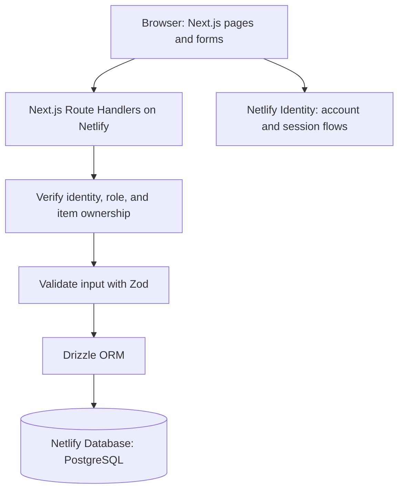

# Shopping Order System — Implementation Plan

## 1. Purpose and scope

Build a simple Next.js application where administrators manage shared shopping lists, signed-in users add items and remove their own items, and everyone can view the lists.

This document describes the proposed implementation only. No application has been built or deployed yet.

### Proposed interpretation

- “Admin can CRUD a list” means an administrator can create, view, rename, update the description of, and delete shopping lists.
- The system supports multiple lists, while remaining simple enough to use with just one.
- “Everybody can see the list” means guests and signed-in users can read lists and items without logging in. Public responses exclude email addresses and authentication details.
- Normal users can add items and remove only items they created. Editing items is outside the initial scope.
- Administrators can also add items and remove any item for moderation.

Guest access and administrator moderation are proposed defaults to confirm before implementation. If “everybody” means registered users only, reading routes will require authentication instead.

## 2. Technologies

| Technology | Purpose |
| --- | --- |
| Next.js App Router + React | Pages, layouts, server rendering, and API Route Handlers |
| TypeScript | Shared types and safer application code |
| Tailwind CSS | Simple responsive styling |
| Netlify hosting and Next.js integration | Deploy the application and run framework server code |
| Netlify Identity with `@netlify/identity` | Email/password accounts, email confirmation, sessions, logout, and password recovery |
| Netlify Database (managed PostgreSQL) | Persistent shopping lists and items |
| `@netlify/database` + Drizzle ORM | Typed database access and schema definitions |
| Zod | Server-side validation of submitted data |

Use compatible stable Next.js and React releases at implementation time. The Netlify Drizzle adapter requires the beta release line of both `drizzle-orm` and `drizzle-kit`; pin the resolved versions in the lockfile.

No payment provider, external database, file storage, or AI service is needed for this version.

## 3. Architecture



Next.js supplies the server runtime through Netlify's framework integration. Use its Route Handlers rather than adding a separate Express server or duplicating API endpoints in standalone functions.

Read pages fetch persistent records on the server. Interactive forms submit mutations to Route Handlers and refresh the displayed data after success. Shared list reads use fresh data rather than a persistent page cache. Automatic polling or live updates are deferred; other visitors see changes when they refresh or revisit the page.

## 4. Roles and permissions

| Action | Guest | Signed-in user | Administrator |
| --- | --- | --- | --- |
| View lists and items | Yes, proposed | Yes | Yes |
| Create a list | No | No | Yes |
| Edit a list | No | No | Yes |
| Delete a list and its items | No | No | Yes |
| Add an item to a list | No | Yes | Yes |
| Remove own item | No | Yes | Yes |
| Remove another user's item | No | No | Yes, proposed |
| Assign administrator roles | No | No | Trusted account administration only |

The interface hides unavailable actions, but every write request independently enforces permissions on the server. Hiding a button is not authorization.

Users receive no privileged role by default. Administrator status comes from server-controlled Identity role metadata; user-editable profile fields never grant permissions. The initial administrator is invited and assigned the `admin` role through the Netlify dashboard. There is no public “become admin” endpoint or automatic promotion of the first signup.

## 5. User experience

### Pages

- `/`: list overview with names, descriptions, item counts, and an administrator-only create button.
- `/lists/[id]`: shared items, quantities, units, notes, and an add-item form for signed-in users. Each user sees remove controls for their own items; administrators see moderation controls.
- `/login` and `/signup`: account entry, with links between the two.
- `/forgot-password`, `/reset-password`, and `/auth/callback`: recovery, confirmation, and invite handling.
- `/admin/lists`: administrator list management with create, edit, and confirmed deletion actions.

### Main flows

1. A visitor opens a list and reads its items.
2. The visitor signs up, confirms their email if required, and logs in.
3. The user adds “Milk”, quantity “2”, unit “bottles”, with an optional note.
4. The server saves the item with the authenticated user's ID as its owner.
5. The user can remove that item but cannot remove another person's item.
6. An administrator creates or updates lists and confirms destructive deletions.

Include loading, empty, success, validation error, unauthorized, and missing-record states. Forms use labels, keyboard navigation, visible focus, and accessible error messages. The layout works on phones and desktops.

## 6. Data model

Account credentials and email addresses remain in Identity. The application database stores list content and the stable Identity user IDs needed for ownership.

### `shopping_lists`

| Field | Type | Rule |
| --- | --- | --- |
| `id` | UUID | Primary key, generated on server |
| `name` | varchar(120) | Required, trimmed, nonempty |
| `description` | varchar(1000) | Optional |
| `created_by` | text | Identity user ID of creating administrator |
| `created_at` | timestamptz | Server timestamp |
| `updated_at` | timestamptz | Updated on edits |

### `shopping_items`

| Field | Type | Rule |
| --- | --- | --- |
| `id` | UUID | Primary key, generated on server |
| `list_id` | UUID | Foreign key to `shopping_lists.id` |
| `name` | varchar(160) | Required, trimmed, nonempty |
| `quantity` | numeric(10,2) | Greater than zero, default 1 |
| `unit` | varchar(30) | Optional, such as kg or bottles |
| `note` | varchar(500) | Optional |
| `owner_id` | text | Verified Identity user ID, never trusted from request body |
| `created_at` | timestamptz | Server timestamp |

Index items by `list_id` and creation time, and add an ownership index where useful. Deleting a list cascades to its items in one database operation after explicit confirmation. Duplicate item names are allowed so users retain independent ownership; the app does not silently merge submissions.

Public responses expose only necessary content and a computed `canDelete` flag where applicable. Do not publish account email addresses or raw owner IDs. Account deletion and historical item retention need a separate policy if account deletion is added later.

## 7. API contract

| Method and route | Purpose | Access |
| --- | --- | --- |
| `GET /api/lists` | Paginated lists with item counts | Public, proposed |
| `POST /api/lists` | Create list | Admin |
| `GET /api/lists/[id]` | Read list details | Public, proposed |
| `PATCH /api/lists/[id]` | Update list name or description | Admin |
| `DELETE /api/lists/[id]` | Delete list and contained items | Admin |
| `GET /api/lists/[id]/items` | Paginated items | Public, proposed |
| `POST /api/lists/[id]/items` | Add item owned by current user | Signed in |
| `DELETE /api/lists/[id]/items/[itemId]` | Remove an owned item or moderate | Owner or admin |

List and item collections use bounded page sizes and deterministic ordering. Return consistent JSON errors and appropriate statuses: `400` invalid input, `401` missing or invalid session, `403` insufficient permission, `404` missing resource, and `500` unexpected failure. Successful creation returns `201`; successful deletion returns `204`.

Ownership checks are part of the delete query, scoped to both list and item. This prevents changing an item ID in a request to delete another user's contribution. Return `404` for a missing or inaccessible item without revealing ownership details.

## 8. Authentication and security

- Use the supported Identity SDK for signup, login, logout, session refresh, and password recovery. Never store passwords in application tables.
- Verify the session on the server for every mutation, then read trusted role claims. Decoding an unverified token is insufficient.
- Handle confirmation, recovery, and invitation callbacks explicitly. A recovery link leads to a password reset form.
- Use centralized `requireUser` and `requireAdmin` helpers so routes share permission rules.
- Require same-origin mutation requests and apply CSRF protection appropriate to the chosen cookie/session integration.
- Validate lengths, numeric ranges, UUIDs, and accepted fields on the server. Render item text as text rather than HTML.
- Use parameterized ORM queries, database constraints, and transactions where needed.
- Disable repeated form submissions while a mutation is pending. Preserve user input after recoverable errors.
- Avoid logging credentials, tokens, full authentication payloads, or private account data. Return safe user-facing errors.

## 9. Proposed project structure

```text
app/
  layout.tsx
  page.tsx
  lists/[id]/page.tsx
  admin/lists/page.tsx
  login/page.tsx
  signup/page.tsx
  forgot-password/page.tsx
  reset-password/page.tsx
  auth/callback/page.tsx
  api/lists/...
components/
  auth/
  shopping-lists/
  shopping-items/
lib/
  auth.ts
  permissions.ts
  validation.ts
db/
  schema.ts
  index.ts
netlify/database/migrations/
docs/implementation-plan.md
drizzle.config.ts
netlify.toml
```

Keep database and authorization modules server-only. Use camelCase in TypeScript and snake_case in database columns. Define the schema in `db/schema.ts`; every schema change includes a generated migration in `netlify/database/migrations/`. Netlify applies migrations during deployment rather than the application applying them on startup.

## 10. Delivery stages

1. **Foundation:** create a Next.js TypeScript project without a generic template, add styling, metadata, navigation, and Netlify configuration.
2. **Authentication:** integrate and activate Identity, add account flows, verify sessions, and document first-admin setup.
3. **Persistence:** define Drizzle tables, constraints, indexes, database client, and initial migration.
4. **List management:** implement list reads and administrator CRUD with deletion confirmation.
5. **Item management:** implement validated additions and ownership-enforced deletion.
6. **Polish and verification:** add responsive and accessible states, permission tests, error handling, and setup documentation.
7. **Deployment:** use a deploy preview to verify actual Identity callbacks, database migrations, and role behavior before production use.

Set finished product metadata to “Shopping Order System” with a concise description of shared lists. Add a README with local setup and an AGENTS document covering architecture and conventions during implementation.

## 11. Acceptance criteria

- Guests can browse lists and items under the proposed public-read policy.
- Signup, email confirmation, login, logout, and password recovery work.
- Normal users cannot create, edit, or delete lists, including through direct API requests.
- Administrators can create, read, update, and delete lists.
- Signed-in users can add valid items and remove their own items.
- A user cannot delete another user's item by modifying a request.
- Administrator moderation follows the agreed policy.
- Deleting a list removes its items without leaving orphan records.
- Data survives refreshes, new sessions, and deployments.
- Expired sessions, invalid input, and deleted records produce clear, safe responses.
- The interface works with a keyboard and on mobile screens.

Targeted permission and API integration tests should cover anonymous writes, forged owner IDs, non-admin list changes, cross-user item deletion, cross-list item IDs, valid operations, and cascade deletion. Use two normal accounts plus one administrator during acceptance checks. The deployment pipeline validates the build; deployed preview checks validate platform integrations.

## 12. Scope boundaries and decisions before implementation

The first version is a collaborative shopping-list system, not a checkout or order-fulfillment service. Payments, product inventory, prices, delivery addresses, notifications, file uploads, live synchronization, and item completion tracking are deferred.

Before implementation, settle these two product decisions:

1. May unauthenticated visitors read the lists, or must every viewer log in?
2. May administrators remove any user's items, or only manage lists and their own items?

This plan proposes public viewing and administrator moderation. Hosting, database, and Identity usage may incur platform charges depending on traffic and account limits; no cost estimate is assumed here.
